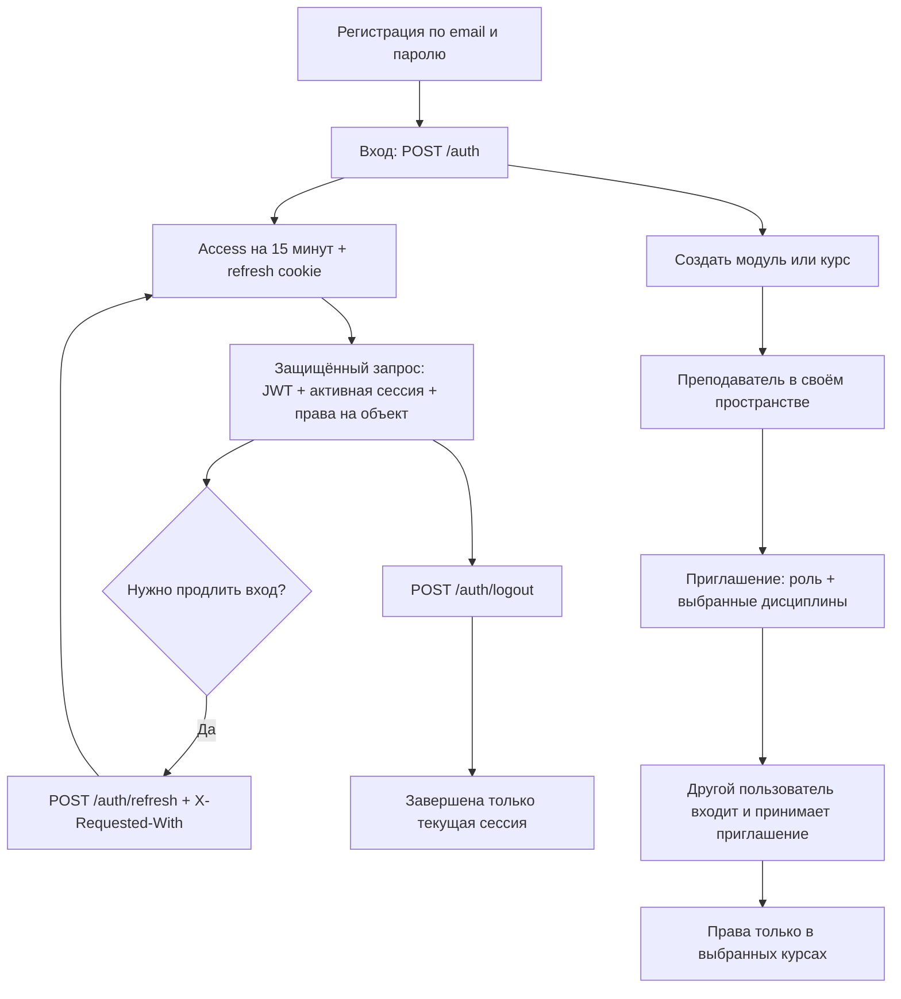

# Аутентификация и права Pocket LMS

Backend-реализация для ревью, 29.10.2026, ветка `feature/authentication`.

## Регистрация и роли

Любой человек самостоятельно регистрируется по email и паролю. Подтверждения email,
внешней почтовой службы и Яндекса нет. Email сравнивается без учёта регистра.
Пароль хранится как scrypt-хеш с индивидуальной случайной солью. Сохранена политика:
8–64 символа, заглавная буква, цифра и подтверждение пароля. Регистрация не принимает
права администратора или роль преподавателя.

Преподаватель — роль внутри конкретного курса, а не глобальная привилегия.
Один человек может быть преподавателем в одном курсе и студентом в другом.
Создатель курса автоматически получает owner; создатель модуля определяется по
curator_id и управляет всеми курсами своего модуля. Права не записаны в JWT:
сервер проверяет актуальные данные БД на каждом защищённом запросе.

## Сессии устройств

| Запрос | Поведение |
|---|---|
| POST /register | Зарегистрировать самостоятельный аккаунт |
| POST /auth | Войти по email и паролю, создать отдельную сессию устройства |
| POST /auth/refresh | Обновить вход с помощью cookie и X-Requested-With: PocketLMS |
| GET /auth/sessions | Посмотреть свои активные устройства, без секретов |
| POST /auth/logout | Выйти только из текущей сессии |
| POST /auth/change_password | Сменить пароль с проверкой текущего, завершить все сессии |

Вход возвращает access_token, token_type=bearer, user_id, session_id, expires_in=900.
Необязательный query device_name задаёт название устройства. Access JWT живёт
15 минут и содержит sub, sid, type=access, iat, exp. Для защищённых запросов нужен
Authorization: Bearer <access_token>. Сохранённый query user_id у get_user_info,
get_modules, get_courses обязан совпадать с пользователем токена.
JWT принимается только при наличии активного пользователя и активной сессии в БД.
Поэтому выход и блокировка действуют сразу, ждать истечения JWT не нужно.

Refresh — случайный секрет из 32 байт. В БД хранится только его SHA-256-хеш,
а браузер получает HttpOnly cookie pocket_lms_refresh (SameSite=Strict, Path=/,
Secure по умолчанию). На локальном HTTP установите AUTH_COOKIE_SECURE=false;
для HTTPS-развёртывания оставьте true. Ответы API имеют Cache-Control: no-store.

Каждый refresh меняет секрет; предыдущий становится одноразово использованным.
Повтор старого refresh завершает связанную с ним сессию, но не другие устройства.
Обязательный нестандартный заголовок защищает refresh от отправки сторонней HTML-формой;
разрешающего CORS в приложении нет. Предполагается один origin frontend/API.

Сессия живёт 90 дней без обновления; успешный refresh продлевает этот срок,
но не далее 365 дней после первоначального входа. Это выбранные настройки первой версии.
Чтобы пользователь оставался в аккаунте, будущий frontend должен автоматически
вызывать refresh: access хранить в памяти, refresh — только в HttpOnly cookie,
не в localStorage. Запросы refresh нужно сериализовать, в том числе между вкладками
(например, Web Locks/BroadcastChannel): два параллельных обновления одного секрета
считаются повторным использованием и завершат сессию. Сейчас frontend ещё не разработан;
Swagger позволяет проверить backend-сценарий, но сам автоматическое обновление не выполняет.

## Восстановление и администрирование

Без внешней почты восстановление выполняется через разработчика:

1. Разработчик вручную проверяет, что обращается владелец аккаунта.
2. POST /admin/password_reset?user_id=... выдаёт одноразовый reset_code на 30 минут.
   Только для admin. Код показывается один раз; в БД хранится хеш.
   Новый код аннулирует предыдущие. Выдача кода сама по себе не меняет пароль.
3. Разработчик передаёт код по проверенному личному каналу.
4. Пользователь вызывает публичный POST /auth/reset_password с reset_code,
   password, password_confirm. Все сессии завершаются, код нельзя использовать снова.

POST /auth/change_password принимает current_password, password, password_confirm.
После смены завершаются все сессии, включая текущую, и аннулируются коды восстановления.
Нужно войти заново. Автоматического восстановления без разработчика в этой версии нет.

PATCH /admin/account_status?user_id=... с JSON {"blocked":true} блокирует аккаунт,
завершает его сессии и отменяет коды восстановления. Разблокировка не возвращает
старые сессии. Администратор не может заблокировать сам себя. Администраторами
являются только разработчики; роль admin нельзя получить через приглашение.

Начальное назначение разработчика выполняется вне HTTP после регистрации аккаунта:

```sh
uv run --env-file .env python scripts/grant_admin.py --email developer@example.com
```

Команду запускает разработчик с доступом к БД; публичного назначения admin нет.
Смена создателя пространства также относится к операциям разработчиков.
Обычный создатель не может передать curator_id другому пользователю через update_module.

## Ограничения попыток и аудит

Счётчики хранятся в общей PostgreSQL, сохраняются при ошибке HTTP и рестарте API.
За 15 минут: вход — 10 попыток на email и 100 на IP; регистрация — 20 на IP;
сброс пароля — 10 на IP; смена пароля — 10 на пользователя; refresh — 100 на IP;
принятие приглашения — 100 на пользователя. Превышение возвращает 429 и Retry-After.
IP определяется по подключению; произвольному X-Forwarded-For приложение не доверяет.
При reverse proxy нужно явно ограничить доверенные proxy в настройках сервера.
Ошибка входа одинакова для неизвестной почты, неверного пароля и блокировки;
для неизвестного аккаунта также выполняется дорогая проверка хеша.
Регистрация сообщает о занятой почте через 409.

security_events фиксирует вход, выход, повтор refresh, смену пароля, выдачу кода,
блокировку, приглашения, исключения и начальное назначение admin. Секреты не логируются.
Для эксплуатации следует периодически удалять истёкшие счётчики, завершённые сессии
вместе с историей refresh и использованные коды восстановления. Срок хранения аудита
команда определяет отдельно; автоматический планировщик очистки пока не добавлен.

## Приглашения по ссылке и коду

POST /create_invitation принимает JSON. В один курс:

```json
{"course_id":"UUID курса","role":"student","expires_in_days":7,"max_uses":100}
```

В выбранные курсы модуля:

```json
{
  "module_id":"UUID модуля",
  "course_ids":["UUID общей дисциплины","UUID углублённой дисциплины"],
  "role":"teacher",
  "expires_in_days":7,
  "max_uses":10
}
```

Укажите либо course_id, либо module_id с непустым course_ids. Курсы разных модулей
смешивать нельзя. Срок 1–30 дней, вместимость 1–1000. По умолчанию 7 дней и 100 принятий.
Выбранные дисциплины фиксируются при создании: новые курсы модуля позднее не добавляются
автоматически. Эти сроки и правило снимка — настройки первой версии, которые можно изменить.

Ответ содержит id, invite_code, invitation_url, область, роль, срок и вместимость.
В БД — только хеш кода. Ссылка вида /join?code=... относительная: frontend должен
добавить свой домен и реализовать страницу вступления; готовой страницы сейчас нет.
Ссылка и код передают один секрет. Принять приглашение может только вошедший пользователь:
POST /accept_invitation?invite_code=.... Роль появляется только после принятия.

Внутри модуля создатель и преподаватель любого его курса имеют равные права на
приглашения: оба могут пригласить студента или преподавателя в любые выбранные
курсы этого модуля. Это не даёт преподавателю права редактировать соседние курсы.
В самостоятельном курсе приглашает его преподаватель.

Повторное принятие тем же аккаунтом идемпотентно и не расходует вместимость.
Оно не восстанавливает членство после исключения — для возвращения нужно новое
приглашение. Приглашение в студенты не понижает действующего преподавателя/создателя.
Вместимость проверяется под блокировкой БД, включая одновременные принятия.
DELETE /revoke_invitation?invitation_id=... запрещает дальнейшие вступления;
ранее принятых участников не исключает. Истечение срока действует так же.
При потере выдавшим преподавателем соответствующих прав или блокировке аккаунта
его приглашение перестаёт давать права новым участникам.

Legacy-поле disciplines.invite_code сохранено в структуре курса, но не даёт права
присоединиться. Старые ссылки нужно заменить новыми приглашениями. При создании
курса поле можно не задавать — оно генерируется; повторное значение возвращает 409.

## Матрица прав

| Действие | Создатель модуля | Преподаватель курса в модуле | Студент |
|---|---|---|---|
| Создать свой модуль/отдельный курс | Да | Да | Да, становится создателем |
| Изменить модуль, добавить в него курс | Да | Нет | Нет |
| Изменить курс | Любой своего модуля | Только свой | Нет |
| Пригласить в выбранные курсы модуля | Да | Да, в любые этого модуля | Нет |
| Материалы, задания, проверка работ | Все курсы своего модуля | Только свой курс | Только чтение доступного опубликованного |
| Удалить материал/задание | Любые в своём модуле | Только созданные им в своём курсе | Нет |
| Исключить студента из курса | Да | Из своего курса | Нет |
| Исключить участника из модуля | Да | Нет | Нет |
| Снять права приглашённого преподавателя | Да | Нет | Нет |
| Снять права создателя | Только разработчики | Нет | Нет |
| Блокировать аккаунт | Только если admin | Только если admin | Нет |

В самостоятельном курсе преподаватель редактирует свой курс, но удаляет только
свои материалы/задания; создатель курса снимает права приглашённых преподавателей.
Admin — техническое исключение для разработчиков, не роль из приглашения.

DELETE /remove_course_member?course_id=...&member_user_id=... исключает с курса.
DELETE /remove_module_member?module_id=...&member_user_id=... исключает из модуля и
всех его курсов. Членство становится left, привязка к команде снимается, история
работ сохраняется. Права создателя нельзя снять этими операциями обычному аккаунту.

У материалов и заданий серверное created_by, которое нельзя подставить через API.
Удаление материала проверяет также авторов вложенных заданий, чтобы каскадное
удаление не обходило запрет на удаление чужих работ. Для старых материалов автор
неизвестен и created_by остаётся NULL: удаляет создатель модуля или admin.
Разработчик может восстановить достоверное авторство вручную.

Студент видит только выбранные дисциплины, включая карточки в модуле.
Курсы, черновики, персональные задания, работы и файлы проверяются по родителям.
Чужие сдачи доступны только преподавателю или разрешённым участникам команды.

## Применение миграции

Перед обновлением рабочей БД сделайте резервную копию. Затем:

```sh
uv run --env-file .env python scripts/migrate.py
```

Скрипт создаёт схему на пустой БД либо применяет 001 и 002 на существующей.
Использует транзакцию, advisory lock, журнал миграций и контрольные суммы.
Повторный запуск не переисполняет уже применённые миграции.
После перезапуска API старые JWT без сессии больше не принимаются: войдите заново.

Добавляются таблицы сессий, использованных refresh, сбросов пароля, счётчиков,
участников модуля, приглашений, выбранных курсов, принятий и аудита; авторство контента.
Исторические создатели курсов становятся owner в списках участников.
Данные пользователей, курсов, сдач и файлов не удаляются. Неиспользуемый legacy-столбец
yandex_id остаётся ради сохранности данных; интеграции с Яндексом нет.

## Демонстрация и границы проверки

Регистрация → вход на двух клиентах → Authorize → создать модуль/курс → пригласить
в выбранные дисциплины с ролью → принять другим аккаунтом → показать разрешённые
и запрещённые действия → refresh → выход на одном устройстве → восстановление через admin.

Интеграционные тесты используют реальные обработчики и отдельную PostgreSQL.
S3-протокол проверяется с имитацией ответов хранилища: это не проверка реального S3.
Frontend, внешняя почта, плановая публикация и финальная оценка модуля в эту задачу
не включены и не объявляются реализованными.


